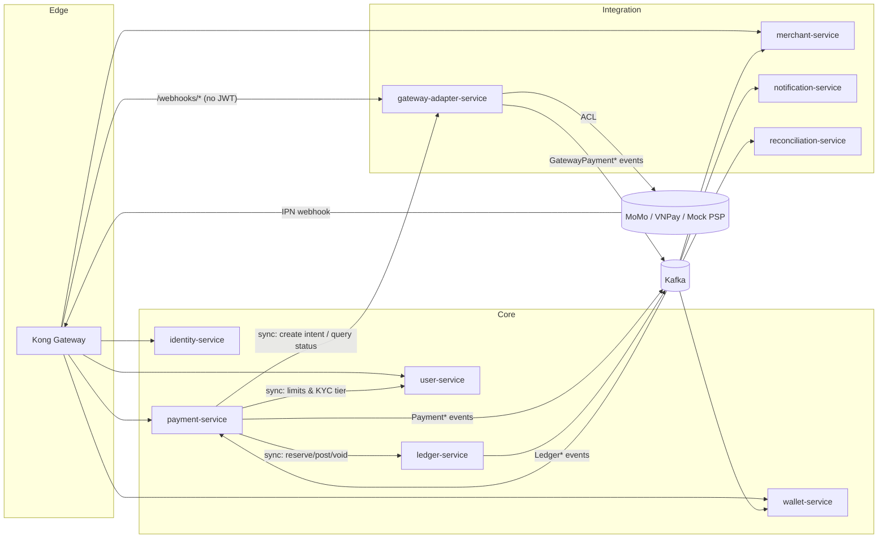
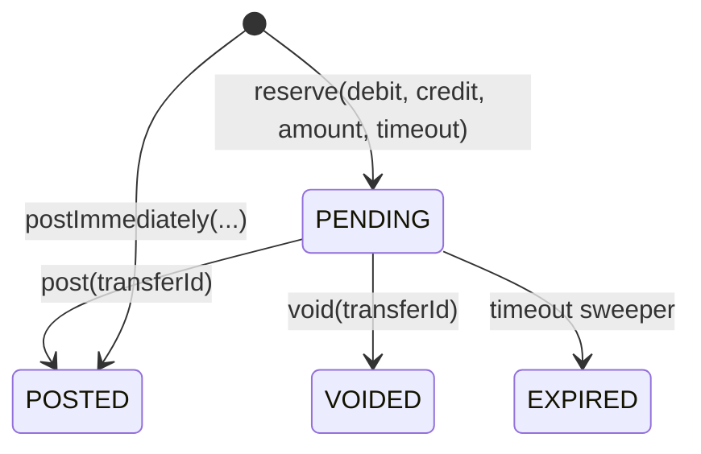
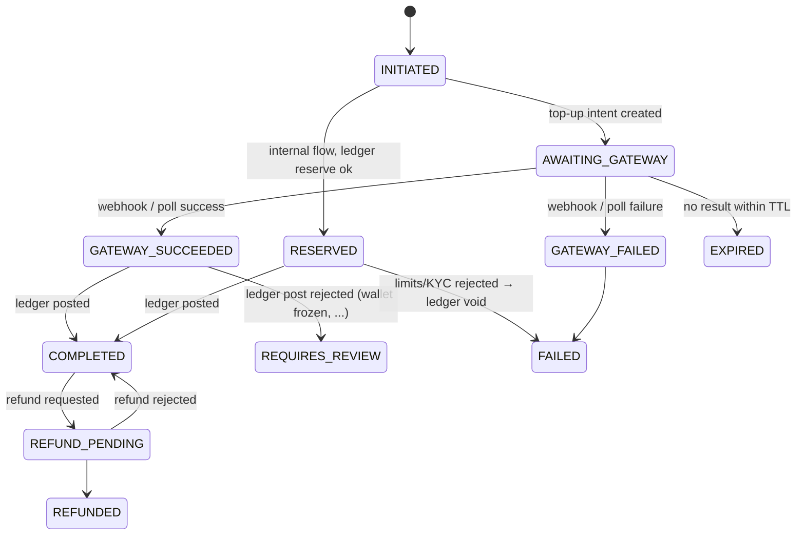
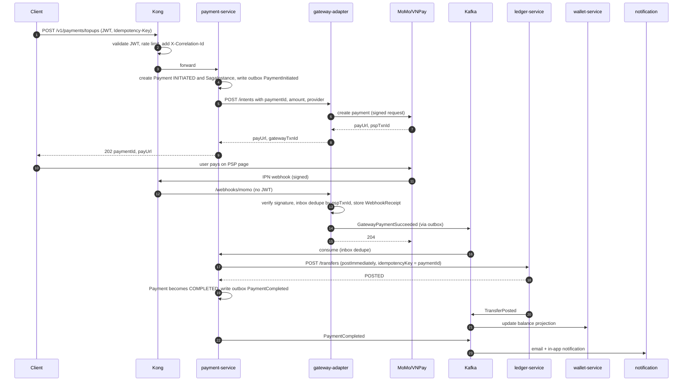

# HL Payment Platform — High-Level Design

| | |
|---|---|
| Status | Proposed |
| Owner | huylq |
| Last updated | 2026-11-08 |
| Related | [ADR index](./adr/), [Roadmap](../backlog/roadmap.md), [Delivery plan](../backlog/delivery-plan.md), [Glossary](../product/glossary.md) |

## 1. Purpose and scope

An educational, production-inspired fintech payment platform. The goal is to practically implement:
Domain-Driven Design, microservices, event-driven architecture, Saga (orchestration and choreography),
transactional outbox/inbox, double-entry bookkeeping, distributed transaction management, fault tolerance,
scalability, and observability.

Core model: **External Money In → Internal Money Movement**. Users top up wallets through Vietnamese
payment gateways (MoMo, VNPay, plus a deterministic Mock PSP) and then move money internally
(P2P transfers, merchant payments, refunds). Withdrawals (money out) arrive in a later phase to exercise
true saga compensation.

Out of scope at this stage: CI/CD, Kubernetes, multi-region, real banking licenses/compliance.

### Money flows

| Flow | Direction | Parties | Learning focus |
|---|---|---|---|
| Top-up | External → Internal | User, PSP (MoMo/VNPay/Mock) | Webhooks, idempotent inbox, orchestration saga, external-state reconciliation |
| P2P transfer | Internal → Internal | User → User | Two-phase ledger transfer, limits/KYC, optimistic locking |
| Merchant payment | Internal → Internal | User → Merchant | Hold/capture/void, HMAC merchant API, outbound webhooks |
| Refund | Internal → Internal | Merchant → User | Reversing postings, partial refunds, idempotency |
| Withdrawal (Phase 4) | Internal → External | User → Mock bank/PSP | Compensation: pending debit → disbursement fails → void |

Currency is VND (minor unit = 1). All amounts are modeled as `amount_minor BIGINT + currency CHAR(3)` so
the ledger remains currency-agnostic.

## 2. Technology stack

| Concern | Choice |
|---|---|
| Language / runtime | Java 25 (virtual threads, `ScopedValue`, records, sealed types, pattern matching) |
| Framework | Spring Boot 4 / Spring Framework 7 (`RestClient`, `@HttpExchange` + `@ImportHttpServices`, native API versioning, core `@Retryable`/`@ConcurrencyLimit`, JSpecify null-safety) |
| Build | Gradle (Kotlin DSL), version catalog, convention plugins in `build-logic/` |
| Edge | **Kong Gateway 3.x (OSS, DB-less declarative config)** |
| Identity | Spring Authorization Server (OAuth2/OIDC, RS256 JWT, JWKS) |
| Persistence | PostgreSQL 17, one database + role per service, Flyway, Spring Data JPA / Hibernate 7 |
| Messaging | Apache Kafka 4 (KRaft), Spring Kafka, JSON events + JSON Schema |
| Cache / coordination | Redis (idempotency keys, rate-limit counters where not handled by Kong) |
| Resilience | Resilience4j (circuit breaker, bulkhead, time limiter) + Spring core retry |
| Observability | OpenTelemetry (Micrometer Tracing, OTLP), Prometheus, Grafana, Tempo, Loki |
| Local infra | Docker Compose: Postgres, Kafka + UI, Redis, Kong, MailHog, OTel Collector, Grafana stack |
| Testing | JUnit 5, jqwik, Testcontainers, ArchUnit, Spring Modulith test support |

## 3. Bounded contexts and services

| # | Service | Bounded context / responsibility | Key aggregates | Database |
|---|---|---|---|---|
| 0 | `kong` (infra, not a Java service) | Edge: routing, JWT validation, rate limiting, correlation-id injection, request size limits, CORS, Prometheus/OTel export | — | — |
| 1 | `identity-service` | OAuth2/OIDC Authorization Server, credentials, RBAC roles/scopes, token issuance (RS256 + JWKS), refresh/revocation | `Credential`, `Role`, `Client` | `identity_db` |
| 2 | `user-service` | Customer profile, KYC simulation (tiers `UNVERIFIED / BASIC / FULL`), account status (`ACTIVE / FROZEN / CLOSED`), per-tier transaction limits | `User`, `KycCase` | `user_db` |
| 3 | `wallet-service` | Wallet lifecycle (open/freeze/close), currency, mapping to ledger account, daily/monthly limit counters, **balance read model** projected from ledger events | `Wallet`, `LimitUsage` | `wallet_db` |
| 4 | `ledger-service` | **System of record for money.** Chart of accounts, double-entry journal, two-phase transfers (pending → post/void), balances, reconciliation hooks | `LedgerAccount`, `JournalEntry`, `Transfer` | `ledger_db` |
| 5 | `payment-service` | Payment lifecycle, saga orchestrator (top-up, transfer, merchant payment, refund, withdrawal), idempotency, fee calculation | `Payment`, `SagaInstance`, `FeeSchedule` | `payment_db` |
| 6 | `gateway-adapter-service` | Anti-Corruption Layer for PSPs (MoMo, VNPay, Mock): create payment intent, verify webhook signatures, inbound webhook inbox, status polling, PSP-neutral events | `GatewayTransaction`, `WebhookReceipt` | `gateway_db` |
| 7 | `merchant-service` | Merchant onboarding, API keys + HMAC request signing, merchant orders, merchant wallet linkage, settlement summaries | `Merchant`, `ApiCredential`, `MerchantOrder` | `merchant_db` |
| 8 | `notification-service` | Email (MailHog locally), in-app notifications, outbound merchant webhooks with retry/backoff, templates | `Notification`, `WebhookDelivery` | `notification_db` |
| 9 | `reconciliation-service` (Phase 4) | Compare PSP settlement reports against ledger and gateway records, flag breaks, propose adjustments | `ReconciliationRun`, `Break` | `recon_db` |
| — | `platform-*` libraries | Cross-cutting code shared through Gradle (§5). Libraries, **not** a runtime service | — | — |

### 3.1 Why `ledger-service` is separate from `wallet-service`

- Wallet is a *product* concept (owner, status, limits). Ledger is an *accounting* concept (accounts, postings, invariants). Different ubiquitous languages and change rates.
- Merchant balances, PSP receivables, fee revenue, and suspense accounts belong in the ledger but are not wallets.
- Forces the real-world problem: wallet balance is a projection, ledger is truth, and the two must be reconciled. See [ADR-0002](./adr/ADR-0002-separate-ledger-service.md).

### 3.2 Why cross-cutting code is a library, not a service

Response envelopes, exception mapping, header validation, and correlation IDs are in-process concerns. A
network hop for them creates a distributed monolith and a single point of failure. Ship them as versioned
libraries that each service pins independently. See [ADR-0003](./adr/ADR-0003-platform-libraries-not-service.md).

### 3.3 Context map



DDD relationship types:

- `gateway-adapter-service` ↔ PSPs: **Anti-Corruption Layer**. Nothing MoMo/VNPay-specific leaks past this service.
- `payment-service` → `ledger-service`: **Customer–Supplier**. Ledger publishes a stable two-phase transfer API; payment conforms.
- `wallet-service` ← `ledger-service` events: **Conformist / Published Language** (events are the contract).
- `platform-*`: deliberately thin **Shared Kernel** — infrastructure types only, never domain types.

## 4. Edge: Kong Gateway

Kong runs in DB-less mode with a declarative `deploy/local/kong/kong.yml`. Kong does coarse-grained
concerns; services remain OAuth2 resource servers and enforce fine-grained authorization themselves
(zero trust between edge and services).

| Route group | Upstream | Kong plugins |
|---|---|---|
| `/v1/auth/**`, `/.well-known/**` | `identity-service` | `rate-limiting`, `correlation-id`, `request-size-limiting` |
| `/v1/users/**`, `/v1/wallets/**`, `/v1/payments/**` | respective service | `jwt` (RS256, public key from identity-service), `rate-limiting` (per consumer), `correlation-id`, `request-transformer` (strip hop-by-hop headers), `request-size-limiting` |
| `/v1/merchant-api/**` | `merchant-service` | `correlation-id`, `rate-limiting`, `ip-restriction` (optional). HMAC verification stays in `merchant-service` (see ADR-0001 for why not Kong `hmac-auth`) |
| `/webhooks/momo`, `/webhooks/vnpay`, `/webhooks/mock` | `gateway-adapter-service` | `correlation-id`, `request-size-limiting`, `ip-restriction` to PSP ranges (local: disabled). **No JWT** — signature verification is done by the adapter |
| `/actuator/**` | blocked at edge | — |

Global plugins: `prometheus`, `opentelemetry` (traces to OTel Collector), `cors`, `request-id`/`correlation-id`
(header `X-Correlation-Id`, generated when missing, echoed downstream). Kong Admin API is bound to
localhost only; Kong Manager OSS is exposed for inspection in local environments.

Rationale and alternatives considered: [ADR-0001](./adr/ADR-0001-kong-api-gateway.md).

## 5. Repository layout

```
hl-payment/
├── settings.gradle.kts
├── gradle/libs.versions.toml                 # single version catalog
├── build-logic/                              # Gradle convention plugins
│   └── src/main/kotlin/
│       ├── hl.java-conventions.gradle.kts    # Java 25 toolchain, JSpecify, error-prone, test defaults
│       ├── hl.spring-service.gradle.kts      # Boot 4 plugin, actuator, OTel, Testcontainers, Flyway
│       └── hl.library.gradle.kts
├── platform/                                 # shared libraries (thin shared kernel)
│   ├── platform-bom/                         # dependency constraints for all platform-* libs
│   ├── platform-core/                        # Money, Currency, typed Ids, Result, Clock, ErrorCode
│   ├── platform-web/                         # ProblemDetail handler, RequiredHeadersFilter, CorrelationIdFilter, Idempotency filter
│   ├── platform-messaging/                   # EventEnvelope, Outbox/Inbox entities + relay, Kafka config, retry/DLT
│   ├── platform-security/                    # resource-server config, JWT → Principal, HMAC verifier
│   ├── platform-observability/               # Micrometer/OTel defaults, MDC bridge, business metrics helpers
│   └── platform-test/                        # Testcontainers fixtures, ArchUnit rules, test data builders
├── services/
│   ├── identity-service/
│   ├── user-service/
│   ├── wallet-service/
│   ├── ledger-service/
│   ├── payment-service/
│   ├── gateway-adapter-service/
│   ├── merchant-service/
│   ├── notification-service/
│   └── reconciliation-service/
├── contracts/                                # machine-readable contracts used by builds/tests
│   ├── openapi/                              # <service>.yaml (generated from code, checked in)
│   └── events/                               # JSON Schema per event type and version
├── deploy/
│   └── local/
│       ├── docker-compose.yml                # postgres, kafka, redis, kong, mailhog, otel, grafana stack
│       ├── kong/kong.yml                     # declarative Kong config
│       ├── postgres/init.sql                 # one database + role per service
│       └── grafana/                          # dashboards, datasources
├── tools/
│   └── mock-psp/                             # deterministic PSP simulator (success/failure/duplicate/late webhooks)
└── docs/                                     # see docs/README.md for the full structure
    ├── product/
    ├── architecture/   (this document, ADRs, cross-cutting, per-service designs)
    ├── domain/
    ├── api/
    ├── backlog/        (roadmap, epics, features, user stories)
    ├── runbooks/
    └── templates/
```

`contracts/` holds machine-readable artifacts consumed by tests; `docs/api/` holds human-readable
explanations and links to them.

### 5.1 Per-service internal structure (hexagonal)

```
services/payment-service/src/main/java/com/hl/payment/
├── domain/                 # pure Java: aggregates, value objects, domain events, domain services, ports
│   ├── model/
│   ├── event/
│   └── port/               # PaymentRepository, LedgerPort, GatewayPort, EventPublisher
├── application/            # use cases, saga orchestrators, transaction boundaries
│   ├── command/
│   ├── saga/
│   └── query/
└── adapter/
    ├── in/web/             # REST controllers, DTOs, API versioning
    ├── in/messaging/       # Kafka listeners → Inbox → use case
    ├── out/persistence/    # JPA entities + mappers (domain never exposes JPA)
    ├── out/messaging/      # Outbox writer
    └── out/http/           # @HttpExchange clients (ledger, user, gateway-adapter)
```

ArchUnit rules (in `platform-test`): `domain` depends on no Spring/JPA; `application` depends on `domain`
only; adapters depend inward.

## 6. Money model: the ledger

### 6.1 Chart of accounts

| Account | Type | Normal balance | Meaning |
|---|---|---|---|
| `PSP_RECEIVABLE:MOMO`, `PSP_RECEIVABLE:VNPAY`, `PSP_RECEIVABLE:MOCK` | Asset | Debit | Money the PSP owes us after a successful top-up, until settlement |
| `BANK_SETTLEMENT` | Asset | Debit | Our bank account where PSP settlements land |
| `USER_WALLET:<walletId>` | Liability | Credit | Money we owe each user |
| `MERCHANT_WALLET:<merchantId>` | Liability | Credit | Money we owe each merchant |
| `FEE_REVENUE` | Revenue | Credit | Fees we charge |
| `PSP_FEE_EXPENSE` | Expense | Debit | Fees the PSP charges us |
| `SUSPENSE` | Liability | Credit | Unmatched inbound money awaiting reconciliation |

Example postings (VND):

| Business event | Postings |
|---|---|
| Top-up 100,000 via MoMo, no platform fee | `Dr PSP_RECEIVABLE:MOMO 100,000` / `Cr USER_WALLET:w1 100,000` |
| P2P transfer 50,000 with 1,000 fee | `Dr USER_WALLET:w1 51,000` / `Cr USER_WALLET:w2 50,000` / `Cr FEE_REVENUE 1,000` |
| Merchant refund 20,000 | `Dr MERCHANT_WALLET:m1 20,000` / `Cr USER_WALLET:w1 20,000` |
| PSP settlement of 100,000 with 1% PSP fee | `Dr BANK_SETTLEMENT 99,000` / `Dr PSP_FEE_EXPENSE 1,000` / `Cr PSP_RECEIVABLE:MOMO 100,000` |
| Top-up succeeded but wallet frozen | `Dr PSP_RECEIVABLE:MOMO 100,000` / `Cr SUSPENSE 100,000` (ops moves it later) |

### 6.2 Two-phase transfers



- `reserve` checks `available = posted_balance − pending_debits ≥ amount` on liability accounts and writes a `PENDING` transfer atomically (optimistic lock on `ledger_account.version`).
- `post` writes immutable `journal_entry` + `posting` rows and updates balances in one DB transaction, then writes `TransferPosted` to the outbox.
- `void` / `EXPIRED` release the reservation. Expiry gives every saga a bounded time to decide.
- Every mutating call carries an `idempotency_key`; replays return the original result.

Invariants (enforced in the domain and covered by property-based tests): every journal entry has ≥ 2
postings; Σ debits = Σ credits; single currency per entry; amounts > 0; append-only — corrections are new
reversing entries, never updates.

### 6.3 Core tables

```sql
ledger_account(id, code, type, currency, posted_balance_minor, pending_debit_minor, pending_credit_minor, version, created_at)
transfer(id, idempotency_key UNIQUE, debit_account_id, credit_account_id, amount_minor, currency, state,
         expires_at, reference_type, reference_id, created_at, finalized_at)
journal_entry(id, transfer_id, description, effective_at, created_at)
posting(id, journal_entry_id, account_id, direction, amount_minor, currency)        -- append-only
outbox_event(id, aggregate_type, aggregate_id, event_type, payload JSONB, headers JSONB, created_at, published_at NULL)
```

## 7. Payment lifecycle and sagas

### 7.1 Payment state machine



### 7.2 Top-up saga (orchestration; `payment-service` is the orchestrator)



Failure handling that must be implemented explicitly:

- **No webhook within N minutes** → `payment-service` schedules a status query through `gateway-adapter`. Webhooks and polls land in the same idempotent inbox, so duplicate outcomes are harmless.
- **Webhook arrives before the `202` is committed** → inbox stores it; a retry picks it up once the Payment exists.
- **Ledger rejects posting (wallet frozen)** → `REQUIRES_REVIEW`; money goes to `SUSPENSE`; an ops action moves it later.
- **Duplicate webhooks, replayed Kafka messages, orchestrator crash mid-step** → saga state is persisted (`saga_instance.step`, `saga_instance.state`) and every step is idempotent, so resume is safe.

### 7.3 Orchestration vs choreography

| Flow | Pattern | Reason |
|---|---|---|
| Top-up, merchant payment, withdrawal, refund | Orchestration (`payment-service`) | Multi-step, needs compensation, one place answers "what is the state of this payment?" |
| Wallet balance projection, notifications, merchant webhooks, limit counters, recon ingestion | Choreography | Pure side effects, no compensation, many consumers |
| P2P transfer | Orchestration, short (reserve → check limits → post/void) | Simple enough to also build a choreography variant as a comparison exercise |

## 8. Messaging: outbox, inbox, envelope

- **Outbox**: every service writes `outbox_event` in the same transaction as the aggregate change. Relay starts as a polling publisher (`SELECT … FOR UPDATE SKIP LOCKED`, batched, marks `published_at`); Phase 4 swaps in Debezium CDC to learn both. Partition key = aggregate id for per-aggregate ordering.
- **Inbox**: `inbox_event(event_id PK, consumer_group, received_at, processed_at)`. Handler inserts the inbox row and applies the business change in one transaction; duplicate `event_id` → skip. Exactly-once *effect* on top of at-least-once delivery.
- **Envelope** (CloudEvents-shaped JSON, defined in `platform-messaging`):

```json
{
  "id": "uuid",
  "type": "payment.completed",
  "version": 1,
  "source": "payment-service",
  "subject": "payment:<paymentId>",
  "time": "2026-11-08T02:00:00Z",
  "correlationId": "…",
  "causationId": "…",
  "traceparent": "…",
  "data": { }
}
```

- **Topics**: `<context>.events.v1` (`payment.events.v1`, `ledger.events.v1`, `gateway.events.v1`, …) plus per-consumer `…retry` and `…dlt` topics (non-blocking retry via Spring Kafka `@RetryableTopic`).
- **Schemas**: JSON Schema in `contracts/events/`; consumers validate on read; additive-only changes within a version. See [ADR-0005](./adr/ADR-0005-json-events-with-json-schema.md).

## 9. Cross-cutting standards (enforced by `platform-*`)

- **Responses**: success returns the resource (no wrapper); errors are RFC 9457 `ProblemDetail` with a stable `code` (`WALLET_FROZEN`, `INSUFFICIENT_FUNDS`, `IDEMPOTENCY_CONFLICT`, …) and `correlationId`.
- **Required headers** on mutating endpoints: `Idempotency-Key`, `X-Correlation-Id` (Kong generates when missing). Idempotency store keeps key + request hash + stored response; same key with a different body → `409 IDEMPOTENCY_CONFLICT`.
- **Context propagation**: `ScopedValue<RequestContext>` carrying correlationId, principal, and tenant; bridged into MDC and outbox headers.
- **API versioning**: Spring Framework 7 native versioning via path prefix `/v1`.
- **Null-safety**: JSpecify `@NullMarked` on every module.
- **Money**: `Money` value object (`long minor + Currency`). Never `BigDecimal` for VND, never `double`.

## 10. Resilience

- Outbound HTTP via `RestClient` + `@HttpExchange` interfaces. Timeouts on everything (connect 2s, read 5s for PSPs).
- Resilience4j on `gateway-adapter` → PSP calls: circuit breaker per provider, bulkhead, retry only on idempotent calls (status query); never retry "create intent" without an idempotent reference.
- Spring Framework 7 `@Retryable` / `@ConcurrencyLimit` for intra-platform calls.
- Virtual threads enabled; DB pools sized deliberately because virtual threads remove the thread cap but not the connection cap.
- Fallbacks: provider circuit open → top-up API returns `503` with `Retry-After`; `GET /v1/topups/providers` excludes the provider based on circuit state.
- Chaos exercises (Phase 4): kill `ledger-service` mid-saga, drop webhooks, duplicate webhooks, Kafka rebalance during processing. Each must end in a consistent state.

## 11. Security

- `identity-service` (Spring Authorization Server): authorization-code + PKCE for users, client-credentials for internal services, RS256 JWTs, JWKS endpoint. Scopes: `wallet:read`, `payment:write`, `merchant:api`, `ops:review`.
- Kong validates JWT signature/expiry at the edge; every service is also a resource server (`platform-security`) and re-validates — zero trust.
- Merchant API: API key + HMAC-SHA256 over `(method, path, timestamp, body)` with a replay window; secrets stored hashed.
- Webhooks: MoMo and VNPay signature verification in the adapter; raw body stored in `webhook_receipt` for audit before parsing.
- PII only in `user-service`; other services store `userId` only. Audit log for `ops:review` actions.

## 12. Observability

- OpenTelemetry (Micrometer Tracing + OTLP) → Tempo; Prometheus metrics; Loki for JSON logs; single Grafana stack. Kong exports traces and metrics through the same collector so a request is traced from the edge.
- Trace continuity across Kafka via `traceparent` in the envelope: one trace from HTTP → webhook → ledger → notification.
- Business metrics: `payments_total{type,status,provider}`, `saga_duration_seconds{type}`, `outbox_lag_seconds`, `inbox_duplicates_total`, `ledger_imbalance_total` (must always be 0), `webhook_signature_failures_total`.
- Initial SLOs: top-up completion p95 after webhook < 2s; outbox lag < 5s; zero ledger imbalance.

## 13. Local infrastructure

Docker Compose: PostgreSQL 17 (single instance, one database + role per service), Kafka 4 KRaft + Kafka UI,
Redis, Kong Gateway (DB-less) + Kong Manager, MailHog, OTel Collector, Prometheus, Grafana, Tempo, Loki.
PSP sandboxes: MoMo test environment, VNPay sandbox, and `tools/mock-psp` — a small Spring app that scripts
success / failure / duplicate / late webhooks deterministically for tests.

## 14. Testing strategy

- Domain: plain JUnit + jqwik property tests on ledger invariants.
- Application: use-case tests with in-memory ports.
- Adapters: Testcontainers (Postgres, Kafka), `@DataJpaTest`, Kafka listener tests through the inbox.
- Architecture: ArchUnit rules from `platform-test`.
- Contracts: OpenAPI generated from controllers and checked into `contracts/openapi/`; event JSON Schemas validated in consumer tests.
- End-to-end: compose-based scenarios for the top-up saga including duplicate / late / missing webhook cases.

## 15. Delivery roadmap (summary)

| Phase | Deliverable | Concepts exercised |
|---|---|---|
| 0 | Monorepo, convention plugins, `platform-*` libs, compose stack with Kong, `identity-service` | Gradle multi-project, Boot 4 baseline, OAuth2, edge routing |
| 1 | `user-service`, `wallet-service`, `ledger-service`; P2P transfer via sync calls; outbox + wallet projection | DDD aggregates, double-entry, two-phase transfers, outbox/inbox |
| 2 | `payment-service` + `gateway-adapter-service` with Mock PSP; top-up saga; polling fallback | Orchestration saga, webhooks, idempotency, ACL |
| 3 | MoMo + VNPay sandboxes; `merchant-service` (HMAC API, merchant payment, refund); `notification-service` | Real integrations, hold/capture, choreography consumers, outbound webhooks |
| 4 | Withdrawal with compensation; `reconciliation-service`; Debezium relay; chaos tests; dashboards/SLOs | Compensation, reconciliation, CDC, resilience engineering |

Detailed plan: [backlog/delivery-plan.md](../backlog/delivery-plan.md). Phase summary: [backlog/roadmap.md](../backlog/roadmap.md).

## 16. Key decisions

| Decision | ADR |
|---|---|
| Kong Gateway as edge instead of Spring Cloud Gateway | [ADR-0001](./adr/ADR-0001-kong-api-gateway.md) |
| Separate `ledger-service` from `wallet-service` | [ADR-0002](./adr/ADR-0002-separate-ledger-service.md) |
| Cross-cutting concerns as libraries, not a service | [ADR-0003](./adr/ADR-0003-platform-libraries-not-service.md) |
| Synchronous REST for `payment-service` → `ledger-service` within sagas | [ADR-0004](./adr/ADR-0004-sync-ledger-calls-in-sagas.md) |
| JSON events + JSON Schema before Avro/Schema Registry | [ADR-0005](./adr/ADR-0005-json-events-with-json-schema.md) |
