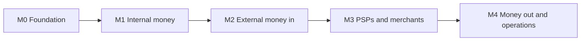

# Delivery plan

| | |
|---|---|
| Status | Proposed |
| Owner | huylq |
| Last updated | 2026-11-09 |
| Phase | 0–4 |
| HLD | [high-level-design.md](../architecture/high-level-design.md) |
| Phase summary | [roadmap.md](./roadmap.md) |

Index of milestones and epics taken from the high-level design. A feature and its user stories are split from the component design, once that design is `Proposed`.

Order:

1. **Milestone and epic**, in this file. A milestone is one roadmap phase. It ends only when its exit checks pass on a running Compose stack.
2. **Component design.** One file per service, from [templates/service-design.md](../templates/service-design.md), at `architecture/services/<service>.md`. Shared infrastructure goes under `architecture/cross-cutting/`. A flow that crosses services is a section of the orchestrating service's design.
3. **Feature and user story.** When the epic moves to `Ready`, copy [templates/epic.md](../templates/epic.md), [feature.md](../templates/feature.md), and [user-story.md](../templates/user-story.md) into `epics/`, `features/`, and `user-stories/`. After the split, those files own status.

M0 is the exception. The HLD already specifies the build, the platform libraries, Compose, and Kong (§2, §4, §5, §8, §9), so those features and stories are listed here. `identity-service` still gets `architecture/services/identity-service.md` before FT-015 is implemented. The stories below are the checklist for that design.

Undelivered epics are `Backlog`. An epic stays there until its design is `Proposed`. Candidate slices under M1–M4 are a sketch for that design. The design confirms, merges, or replaces each slice before it becomes a feature. Open questions are answered in the design named beside them.

Sizes: **S** one module or endpoint, **M** one aggregate or adapter, **L** a new service or cross-service flow, **XL** a flow with several failure paths.

## Milestone map

| Milestone | Phase | Outcome | Epics | Exit |
|---|---|---|---|---|
| M0 Foundation | 0 | Boot 4 monorepo, platform libraries, Compose, Kong, identity | EP-001–EP-004 | A token from `identity-service` passes Kong to a protected `/v1/ping`, and the trace is in Grafana Tempo |
| M1 Internal money | 1 | Ledger is the system of record; wallets project it; P2P posts or voids | EP-005–EP-008 | Property tests hold ledger invariants. A P2P updates both wallet projections. Restarting `wallet-service` mid-flow converges |
| M2 External money in | 2 | Top-up through Mock PSP, including duplicate, late, and missing webhooks | EP-009–EP-010 | Every Mock PSP script ends with a consistent Payment and ledger. Duplicate webhooks create one posting |
| M3 Real PSPs and merchants | 3 | MoMo and VNPay sandboxes, merchant pay and refund, notifications | EP-011–EP-013 | Top up via VNPay sandbox, pay a merchant order, partial refund. Merchant receives signed webhooks. Ledger matches |
| M4 Money out and operations | 4 | Withdrawal compensation, reconciliation, CDC, chaos, SLOs, Avro on one topic | EP-014–EP-016 | Chaos scenarios stay consistent. An injected break is detected. Dashboards show the SLOs. One topic is published as Avro |

Out of every milestone, matching the HLD: CI/CD, Kubernetes, multi-region, and real banking licenses. Currency of record for exits is VND. `Money` stays `amount_minor` + `currency`.

## Planning assumptions

These are not ADRs. They are inputs to the component design. Change them there, before the epic is split into features.

- The polling outbox is the relay through M3. Debezium replaces it in the EP-016 design. Payloads stay the same.
- Events are JSON with JSON Schema through M3. EP-016 publishes one topic as Avro through Schema Registry. That comparison is required to exit M4. JSON stays the default.
- `payment-service` is the only saga orchestrator. Wallet balance, notifications, merchant summaries, and reconciliation ingest are choreography.
- Idempotency responses live in Redis, as the HLD states. Kong does rate limiting; services do not duplicate it.
- `user-service` owns KYC tier policy and account status. `wallet-service` owns limit usage and exposes a synchronous check-and-increment used in the same step as a ledger reserve. The Kafka projection updates balances; it is not the authority for a limit decision.
- Top-up webhook TTL defaults to a configurable 15 minutes until a product value is chosen.
- Per-tier limit amounts and the fee schedule are fixtures. The HLD example (transfer 50,000 VND, fee 1,000 VND) is the P2P fixture, not a pricing decision.
- PII stays in `user-service`. Other services store `userId` only.

## Open questions

Answer these in the design named here, before splitting the slices they block.
Draft answers (not Accepted until promoted): [open-question-drafts.md](./open-question-drafts.md).

| # | Question | Blocks | Where to write the answer |
|---|---|---|---|
| Q1 | The HLD sketches `transfer` as one debit account and one credit account, but the fee and PSP-settlement examples need three postings. Is a transfer N balanced legs, or several paired transfers submitted together? | FT-020, FT-030, FT-058 | `architecture/services/ledger-service.md` |
| Q2 | MoMo and VNPay sandbox signature algorithms, field lists, and IP ranges come from their current sandbox docs, not from the HLD. | FT-042, FT-043 | `architecture/services/gateway-adapter-service.md` |
| Q3 | Who exposes the ops action that moves `SUSPENSE` to a user wallet: `payment-service` (orchestrates) or `ledger-service` (posts)? Assumption until reversed: `payment-service` under scope `ops:review`, ledger only posts. | FT-059 | `architecture/services/payment-service.md` |

---

## M0 — Foundation

Concepts: Gradle multi-project, Spring Boot 4 baseline, OAuth2/OIDC, edge routing, the observability pipeline.

Build order: EP-001, then EP-002 and EP-003 in parallel, then EP-004.

Not in M0: user, wallet, ledger, payment, gateway, merchant, notification. No business Kafka topics yet. The probe app is a template, not a bounded context.

Design for EP-001, EP-002, and EP-003 is the HLD. EP-004 also writes `architecture/services/identity-service.md` before FT-015 is implemented.

### EP-001 — Monorepo and build conventions

Design: [EP-001-monorepo-and-build-conventions.md](./epics/EP-001-monorepo-and-build-conventions.md).

| | |
|---|---|
| Status | In progress |
| Size | M |
| Services | `build-logic` |
| Depends on | — |
| Design | HLD §2, §5 |

One Gradle build pins Java 25, Spring Boot 4, and the test stack so later services do not invent their own.

| ID | Feature | Size | Status | Scope |
|---|---|---|---|---|
| FT-001 | [Version catalog and settings](./features/FT-001-version-catalog-and-settings.md) | S | Done | Catalog, wrapper, and settings register `build-logic`. A later module is one `include` |
| FT-002 | Convention plugins | M | Backlog | `hl.java-conventions` (toolchain, JSpecify, tests), `hl.spring-service` (Boot 4, actuator, OTel, Flyway, Testcontainers), `hl.library` |
| FT-003 | Single check entrypoint | S | Backlog | `./gradlew check` compiles and tests every included project |
| FT-064 | Service scaffold | S | Backlog | A `build-logic` task creates a service directory, one `include`, and a build file that applies `hl.spring-service`. Versions stay in the catalog |

| ID | Feature | Status | Story |
|---|---|---|---|
| [US-001](./user-stories/US-001-one-version-catalog.md) | FT-001 | Done | As a developer, I want one version catalog so Boot, Kafka, Flyway, and Testcontainers versions are declared once. |
| [US-002](./user-stories/US-002-one-include-in-settings.md) | FT-001 | Done | As a developer, I want adding a module to be one include in settings. |
| US-003 | FT-002 | Backlog | As a developer, I want Java 25, `@NullMarked`, and JUnit 5 defaults applied without copying build scripts. |
| US-004 | FT-002 | Backlog | As a developer, I want a Spring service plugin that already applies actuator, OpenTelemetry, Flyway, and Testcontainers. |
| US-005 | FT-002 | Backlog | As a developer, I want a library plugin for `platform-*` modules that are not Boot applications. |
| US-006 | FT-003 | Backlog | As a developer, I want `./gradlew check` to be the only local gate for the monorepo. |
| US-108 | FT-064 | Backlog | As a developer, I want a task that creates a service module on `hl.spring-service` so I do not start from Spring Initializr. |

FT-064 is numbered after the rest of the plan so existing ids stay stable. It depends on FT-002 and on the EP-004 probe. The probe is written by hand and is the skeleton the task copies. The task adds `services/<name>/`, one `include("services:<name>")` line, a build file whose `plugins` block is `id("hl.spring-service")`, and the root `package-info.java` with `@NullMarked`. It writes no version, no wrapper, and no `repositories` block. A `platform-*` module stays one `include` plus `id("hl.library")`. FT-064 does not block the M0 exit.

### EP-002 — Platform libraries

| | |
|---|---|
| Status | Backlog |
| Size | L |
| Services | `platform-bom`, `platform-core`, `platform-web`, `platform-messaging`, `platform-security`, `platform-observability`, `platform-test` |
| Depends on | EP-001 |
| Design | HLD §5, §8, §9, §12, §14. [ADR-0003](../architecture/adr/ADR-0003-platform-libraries-not-service.md), [ADR-0005](../architecture/adr/ADR-0005-json-events-with-json-schema.md) |

Thin shared kernel: infrastructure types only, never domain types. Each service pins the BOM.

| ID | Feature | Size | Status | Scope |
|---|---|---|---|---|
| FT-004 | `platform-bom` | S | Backlog | Dependency constraints for every `platform-*` library |
| FT-005 | `platform-core` | M | Backlog | `Money`, `Currency`, typed ids, `Result`, `Clock`, `ErrorCode` |
| FT-006 | `platform-web` | M | Backlog | RFC 9457 `ProblemDetail`, required headers, correlation id, idempotency filter backed by Redis |
| FT-007 | `platform-messaging` | L | Backlog | `EventEnvelope`, outbox and inbox, polling relay, retry and DLT topic config |
| FT-008 | `platform-security` | M | Backlog | Resource-server JWT validation, principal mapping, HMAC-SHA256 verifier |
| FT-009 | `platform-observability` | M | Backlog | Micrometer/OTel defaults, MDC bridge, `ScopedValue` request context, metric helpers |
| FT-010 | `platform-test` | M | Backlog | Postgres and Kafka Testcontainers, ArchUnit rules, JSON Schema validation helper, test data builders |

| ID | Feature | Status | Story |
|---|---|---|---|
| US-007 | FT-004 | Backlog | As a developer, I want platform libraries to import one BOM so their versions move together. |
| US-008 | FT-005 | Backlog | As a developer, I want `Money` as a long minor amount plus currency so VND is never `BigDecimal` or `double`. |
| US-009 | FT-005 | Backlog | As a developer, I want typed ids, `Result`, `Clock`, and stable error codes shared as infrastructure types only. |
| US-010 | FT-006 | Backlog | As an API client, I want the resource on success and `ProblemDetail` on failure, with a stable `code` and `correlationId`. |
| US-011 | FT-006 | Backlog | As an API client, I want a repeated `Idempotency-Key` with the same body to replay the stored response, and a different body to return `409 IDEMPOTENCY_CONFLICT`. |
| US-012 | FT-006 | Backlog | As a caller, I want `X-Correlation-Id` created when I omit it and echoed on the response. |
| US-013 | FT-007 | Backlog | As a service, I want the outbox row in the same database transaction as the aggregate change. |
| US-014 | FT-007 | Backlog | As a service, I want a polling relay using `FOR UPDATE SKIP LOCKED` that sets `published_at` after a successful publish. |
| US-015 | FT-007 | Backlog | As a consumer, I want the inbox insert and the business write in one transaction so a duplicate `event_id` is skipped. |
| US-016 | FT-007 | Backlog | As a consumer, I want the envelope to carry id, type, version, source, subject, time, `correlationId`, `causationId`, and `traceparent`. |
| US-017 | FT-007 | Backlog | As a consumer, I want a per-consumer retry topic and a DLT topic, without blocking the partition. |
| US-018 | FT-008 | Backlog | As a service, I want to validate the RS256 JWT myself and map scopes onto a principal. |
| US-019 | FT-008 | Backlog | As a library user, I want HMAC-SHA256 over method, path, timestamp, and body, rejected outside the replay window. |
| US-020 | FT-009 | Backlog | As an operator, I want JSON logs with the correlation id in MDC, and helpers for the business meters named in the HLD. |
| US-021 | FT-009 | Backlog | As a service, I want correlation id and principal in a `ScopedValue`, copied into MDC and outbox headers. |
| US-022 | FT-010 | Backlog | As a developer, I want shared Testcontainers fixtures for PostgreSQL and Kafka. |
| US-023 | FT-010 | Backlog | As a developer, I want ArchUnit to fail when `domain` touches Spring or JPA, when `application` leaves `domain`, or when an adapter is imported inward. |
| US-024 | FT-010 | Backlog | As a developer, I want a test helper that validates an event payload against `contracts/events`. |

### EP-003 — Local infrastructure and Kong

| | |
|---|---|
| Status | Backlog |
| Size | L |
| Services | `deploy/local` |
| Depends on | EP-001 |
| Design | HLD §4, §13. [ADR-0001](../architecture/adr/ADR-0001-kong-api-gateway.md) |

| ID | Feature | Size | Status | Scope |
|---|---|---|---|---|
| FT-011 | Data and messaging Compose | M | Backlog | PostgreSQL 17, Kafka 4 KRaft, Kafka UI, Redis, MailHog |
| FT-012 | Observability Compose | M | Backlog | OTel Collector, Prometheus, Grafana, Tempo, Loki, provisioned datasources |
| FT-013 | Database per service | S | Backlog | `init.sql` creates one database and one role per service |
| FT-014 | Kong DB-less | M | Backlog | Declarative `kong.yml`, admin API on localhost, Kong Manager for local inspection |

| ID | Feature | Status | Story |
|---|---|---|---|
| US-025 | FT-011 | Backlog | As a developer, I want Postgres, Kafka, Kafka UI, Redis, and MailHog from one Compose file. |
| US-026 | FT-012 | Backlog | As a developer, I want traces, metrics, and logs wired to Grafana before any business service exists. |
| US-027 | FT-013 | Backlog | As a service, I want my own database and role so services cannot read each other's tables. |
| US-028 | FT-014 | Backlog | As an operator, I want Kong loaded from `kong.yml` with the admin API bound to localhost. |
| US-029 | FT-014 | Backlog | As a caller, I want correlation id, request-size limiting, CORS, Prometheus, and OpenTelemetry applied globally. |
| US-030 | FT-014 | Backlog | As an operator, I want `/actuator/**` unreachable through Kong. |

M0 ships route groups only for auth, JWKS, and the probe. Later milestones append routes; they do not replace this file.

### EP-004 — Identity and zero-trust edge

| | |
|---|---|
| Status | Backlog |
| Size | L |
| Services | `identity-service`, probe app |
| Depends on | EP-002, EP-003 |
| Design | HLD §4, §11, then `architecture/services/identity-service.md` before FT-015 |

Kong checks the JWT. The probe checks it again. Bypassing Kong must still fail closed.

| ID | Feature | Size | Status | Scope |
|---|---|---|---|---|
| FT-015 | Authorization server | L | Backlog | Authorization code + PKCE, client credentials, RS256, JWKS, refresh, revocation |
| FT-016 | Roles and scopes | S | Backlog | Roles `CUSTOMER`, `OPS`, `ADMIN`. Scopes `wallet:read`, `payment:write`, `merchant:api`, `ops:review` |
| FT-017 | Edge proof | M | Backlog | Probe service behind Kong `jwt`, resource server inside the process, trace visible in Tempo |

| ID | Feature | Status | Story |
|---|---|---|---|
| US-031 | FT-015 | Backlog | As a user, I want authorization code with PKCE to return an RS256 access token. |
| US-032 | FT-015 | Backlog | As an internal client, I want the client-credentials grant. |
| US-033 | FT-015 | Backlog | As Kong, I want a JWKS URL whose key verifies tokens this server issued. |
| US-034 | FT-015 | Backlog | As a user, I want refresh, and I want revocation to reject that refresh token afterward. |
| US-035 | FT-016 | Backlog | As an admin, I want the HLD scopes attached to `CUSTOMER`, `OPS`, and `ADMIN`. |
| US-036 | FT-017 | Backlog | As a developer, I want `GET /v1/ping` to return 401 when the JWT is missing or invalid even if the request never passed Kong. |
| US-037 | FT-017 | Backlog | As a developer, I want one Tempo trace that includes the Kong span and the probe span for a successful ping. |

**M0 exit:** US-036 and US-037 pass against Compose. `./gradlew check` is green.

---

## M1 — Internal money

Concepts: DDD aggregates, double-entry bookkeeping, optimistic locking, outbox/inbox, projections.

Build order: `ledger-service.md` first (Q1), then EP-005 and EP-006 in parallel, then EP-007, then EP-008. Split features only after the design named on the epic is `Proposed`.

Not in M1: PSPs, webhooks, merchant HMAC, notifications, withdrawal. P2P is the only Payment type. The choreography variant of P2P is stretch and is not an exit check.

Hexagonal layout for every service from here: `domain`, `application`, `adapter.in`, `adapter.out`. ArchUnit from FT-010 runs in each service.

### EP-005 — Ledger system of record

| | |
|---|---|
| Status | Backlog |
| Size | XL |
| Services | `ledger-service` |
| Depends on | EP-002, EP-004 |
| Design | `architecture/services/ledger-service.md` |
| HLD | §3.1, §6. [ADR-0002](../architecture/adr/ADR-0002-separate-ledger-service.md), [ADR-0004](../architecture/adr/ADR-0004-sync-ledger-calls-in-sagas.md) |

Synchronous API used by sagas: reserve, post, void, post immediately. Events notify everyone else. Balances move only inside the ledger database transaction.

Candidate scope, for the design to confirm:

| ID | Slice | Size | Sketch |
|---|---|---|---|
| FT-018 | Posting shape | S | Q1, written in the ledger design before any transfer API |
| FT-019 | Chart of accounts | M | Open system accounts and per-owner wallet accounts. Currency on the account |
| FT-020 | Two-phase transfer | L | `PENDING → POSTED`, `VOIDED`, or `EXPIRED`. Optimistic lock on `ledger_account.version`. Idempotency key on every mutation |
| FT-021 | Journal invariants | M | Append-only postings. jqwik tests for the HLD invariants |
| FT-022 | Ledger events | M | Outbox onto `ledger.events.v1` after post, void, and expiry |

Carry into the design: system accounts `PSP_RECEIVABLE` per provider, `BANK_SETTLEMENT`, `FEE_REVENUE`, `PSP_FEE_EXPENSE`, and `SUSPENSE` with the HLD normal balance. Per-owner accounts `USER_WALLET:<walletId>` and `MERCHANT_WALLET:<merchantId>`, one currency each. Invariants: at least two postings, debits equal credits, a single currency, amounts greater than zero, corrections are new reversing entries. Proposed event types, to confirm in the event catalog: `ledger.transfer.posted`, `ledger.transfer.voided`, `ledger.transfer.expired`.

### EP-006 — Customer profile, KYC, and limits

| | |
|---|---|
| Status | Backlog |
| Size | M |
| Services | `user-service` |
| Depends on | EP-002, EP-004 |
| Design | `architecture/services/user-service.md` |
| HLD | §3, §11 |

Candidate scope:

| ID | Slice | Size | Sketch |
|---|---|---|---|
| FT-023 | Profile and account status | M | `User` with `ACTIVE`, `FROZEN`, `CLOSED` |
| FT-024 | KYC tier | M | Simulated `KycCase`. Tiers `UNVERIFIED`, `BASIC`, `FULL` |
| FT-025 | Tier limit policy | S | Sync read of status, tier, and the fixture caps. No PII in the response beyond what the caller already holds |

Carry into the design: ops can freeze and close a user so later payments reject them. `payment-service` reads status and tier by `userId` and stores no profile fields.

### EP-007 — Wallet lifecycle and balance projection

| | |
|---|---|
| Status | Backlog |
| Size | L |
| Services | `wallet-service` |
| Depends on | EP-005 |
| Design | `architecture/services/wallet-service.md` |
| HLD | §3.1, §8 |

The wallet stores a projection. The ledger balance is truth. Opening a wallet opens its ledger account.

Candidate scope:

| ID | Slice | Size | Sketch |
|---|---|---|---|
| FT-026 | Wallet lifecycle | M | Open, freeze, close. One wallet maps to one ledger liability account |
| FT-027 | Balance projection | L | Inbox consumer on `ledger.events.v1`. Available balance = posted balance minus pending debits, as projected |
| FT-028 | Limit usage | M | Synchronous check-and-increment of daily and monthly usage. See planning assumptions |

Carry into the design: opening a VND wallet creates `USER_WALLET:<walletId>`. A crash during consumption converges after restart and does not apply an event twice. The limit call rejects when the increment would pass the daily or monthly cap, and repeats safely on the same idempotency key.

### EP-008 — P2P transfer

| | |
|---|---|
| Status | Backlog |
| Size | L |
| Services | `payment-service`, `ledger-service`, `user-service`, `wallet-service` |
| Depends on | EP-005, EP-006, EP-007 |
| Design | P2P section of `architecture/services/payment-service.md`, after the three designs above are `Proposed` |
| HLD | §7.1, §7.3, §7.4 |

Short orchestration: reserve, check status and limits, post or void. This is the first slice of `payment-service`, not the full saga machine (that is EP-010).

Candidate scope:

| ID | Slice | Size | Sketch |
|---|---|---|---|
| FT-029 | P2P command API | M | `POST /v1/payments/transfers` with `Idempotency-Key`, behind Kong JWT and `payment:write` |
| FT-030 | Reserve, check, post or void | L | Includes the fixture fee once Q1 is decided: debit 51,000, credit destination 50,000, credit `FEE_REVENUE` 1,000 |
| FT-031 | Choreography comparison | S | Stretch write-up or alternate path. Not required for M1 exit |

Carry into the design: a frozen account, insufficient available balance, or a breached limit voids the reservation. Kong routes `/v1/users/**`, `/v1/wallets/**`, and `/v1/payments/**` require JWT.

**M1 exit:** ledger invariants hold, a wallet crash mid-consumption converges, and a P2P that passes KYC and limits posts both projections. The failure path voids the reservation.

---

## M2 — External money in

Concepts: orchestration saga, anti-corruption layer, idempotency, webhooks, process timeouts.

Build order: EP-009 design, then EP-010 design. Ledger, wallet, and user from M1 stay as they are.

Not in M2: MoMo, VNPay, merchants, notifications, withdrawal, reconciliation.

### EP-009 — Gateway adapter and Mock PSP

| | |
|---|---|
| Status | Backlog |
| Size | L |
| Services | `gateway-adapter-service`, `tools/mock-psp` |
| Depends on | EP-002, EP-003, EP-005 |
| Design | `architecture/services/gateway-adapter-service.md` |
| HLD | §3, §7.2, §10 |

The adapter is the anti-corruption layer. Callers see a provider code and a gateway transaction, never a MoMo or VNPay payload.

Candidate scope:

| ID | Slice | Size | Sketch |
|---|---|---|---|
| FT-032 | Mock PSP | M | Deterministic scripts: success, failure, duplicate webhook, late webhook, no webhook |
| FT-033 | Payment intent | M | Create intent, return pay URL and gateway transaction id |
| FT-034 | Webhook inbox | L | Verify signature, store `WebhookReceipt` raw body first, dedupe by PSP transaction id, publish via outbox |
| FT-035 | Status query | S | Idempotent poll. Safe to retry. Create-intent is not retried unless the provider reference is idempotent |
| FT-036 | Webhook route | S | Kong `/webhooks/mock` has no JWT. Local IP restriction off |

Carry into the design: a bad signature counts on `webhook_signature_failures_total` and is not published as success. The mock PSP receives `204` once the receipt is stored, including when the PSP transaction id was already seen. Proposed event types: `gateway.payment.succeeded`, `gateway.payment.failed` on `gateway.events.v1`.

### EP-010 — Top-up saga

| | |
|---|---|
| Status | Backlog |
| Size | XL |
| Services | `payment-service`, `gateway-adapter-service`, `ledger-service`, `wallet-service` |
| Depends on | EP-007, EP-008, EP-009 |
| Design | Top-up section of `architecture/services/payment-service.md` |
| HLD | §7.1, §7.2 |

`payment-service` owns `Payment` and `SagaInstance`. Every step is idempotent so a crash resumes from `saga_instance.step`.

Candidate scope:

| ID | Slice | Size | Sketch |
|---|---|---|---|
| FT-037 | Saga persistence | M | Payment state machine through `AWAITING_GATEWAY`, `GATEWAY_SUCCEEDED`, `GATEWAY_FAILED`, `EXPIRED`, `COMPLETED`, `FAILED` |
| FT-038 | Happy-path top-up | L | 202 with pay URL, webhook, post-immediately, `PaymentCompleted`, wallet projection |
| FT-039 | Timing and duplicates | L | Poll after TTL, early webhook, duplicate webhook, replayed Kafka record, orchestrator crash |
| FT-040 | Requires review | M | Ledger rejects (wallet frozen) → `REQUIRES_REVIEW` and credit `SUSPENSE` |
| FT-041 | Compose scenarios | M | End-to-end scripts for the four webhook timings |

Carry into the design: `Payment` and `SagaInstance` commit before the 202. Success posts `Dr PSP_RECEIVABLE:MOCK / Cr USER_WALLET`. A missing webhook causes one status query that shares the idempotent inbox with webhooks. A webhook that arrives before the 202 is stored and applied once the Payment exists. Duplicate webhooks and replayed records produce one ledger posting. A kill after gateway success and before the ledger post resumes into a single `COMPLETED` payment.

**M2 exit:** duplicate webhooks create one posting, and the four webhook timings pass on Compose. Provider circuit breaker waits until EP-011. Mock PSP failures still end in `FAILED` with no posted user credit.

---

## M3 — Real PSPs, merchants, and notifications

Concepts: real sandbox integrations, hold/capture, choreography consumers, outbound webhook delivery.

Build order: EP-011 and the onboarding half of EP-012 can run in parallel after M2. Hold/capture waits on the ledger reserve API from M1. EP-013 starts once `payment.*` events exist; merchant webhook delivery waits on the credential slice.

Not in M3: withdrawal, settlement files, Debezium, chaos suite. PSP settlement postings are M4 because they need a settlement report.

### EP-011 — MoMo and VNPay sandboxes

| | |
|---|---|
| Status | Backlog |
| Size | L |
| Services | `gateway-adapter-service` |
| Depends on | EP-009, EP-010 |
| Design | Provider section of `architecture/services/gateway-adapter-service.md`. Q2 is the first part of that section |
| HLD | §10, §11 |

Same saga as Mock. New code is provider adapters plus resilience.

Candidate scope:

| ID | Slice | Size | Sketch |
|---|---|---|---|
| FT-042 | MoMo sandbox | L | Signed create-intent, IPN verification, raw body stored before parse |
| FT-043 | VNPay sandbox | L | Same port as MoMo, VNPay field mapping inside the adapter only |
| FT-044 | Provider resilience | M | Circuit breaker, bulkhead, and time limiter per provider. Connect timeout 2s, read timeout 5s |

Carry into the design: create-intent is not retried blindly; only the status query is retried. An open circuit returns `503` with `Retry-After`, and `GET /v1/topups/providers` omits that provider. Kong: `/webhooks/momo` and `/webhooks/vnpay`, no JWT. IP restriction stays configurable and off for local sandboxes.

### EP-012 — Merchant payments and refunds

| | |
|---|---|
| Status | Backlog |
| Size | XL |
| Services | `merchant-service`, `payment-service`, `ledger-service` |
| Depends on | EP-005, EP-008, EP-010 |
| Design | `architecture/services/merchant-service.md`, and the hold/capture section of `architecture/services/payment-service.md` |
| HLD | §3, §6.1, §7.1, §11 |

HMAC stays in `merchant-service`, not in the Kong `hmac-auth` plugin.

Candidate scope:

| ID | Slice | Size | Sketch |
|---|---|---|---|
| FT-045 | Merchant onboarding | M | `Merchant`, link to `MERCHANT_WALLET` |
| FT-046 | API credentials | M | API key, hashed secret, HMAC on `/v1/merchant-api/**`. Kong: correlation id, rate limit, optional IP restriction |
| FT-047 | Merchant order | M | `MerchantOrder` a customer can pay |
| FT-048 | Hold, capture, void | L | Orchestrated reserve, then post or void. Expired reserve is the ledger sweeper |
| FT-049 | Refund | L | Full and partial. Reversing entries. `REFUND_PENDING → REFUNDED`, or back to `COMPLETED` when rejected |
| FT-050 | Settlement summary | M | Choreography read model for the merchant. Not a PSP settlement |

Carry into the design: a bad signature or a stale timestamp is rejected by `merchant-service` even when Kong forwarded the call. A partial refund debits the merchant wallet, credits the user wallet, and leaves the remainder captured. A refund that fails validation restores `COMPLETED` and replays safely on the same idempotency key. The summary is rebuildable from the ledger.

### EP-013 — Notifications and outbound webhooks

| | |
|---|---|
| Status | Backlog |
| Size | M |
| Services | `notification-service` |
| Depends on | EP-008, EP-010, FT-046 |
| Design | `architecture/services/notification-service.md` |
| HLD | §3, §7.4 |

Pure choreography. No compensation. Delivery failure does not change Payment state.

Candidate scope:

| ID | Slice | Size | Sketch |
|---|---|---|---|
| FT-051 | Customer notification | M | Email via MailHog and an in-app `Notification` on payment completed, failed, and refunded |
| FT-052 | Merchant webhook delivery | L | Signed POST, retry with backoff, `WebhookDelivery` log, terminal failure visible for replay |

Carry into the design: a delivery that exhausted retries stays failed and does not move the Payment backward.

**M3 exit:** a VNPay sandbox top-up, a capture, a partial refund, and a signed merchant webhook run as one scenario. Ledger postings match the HLD refund example.

---

## M4 — Money out, reconciliation, and resilience

Concepts: compensation, reconciliation, CDC, fault injection, SLOs.

Build order: EP-014 and EP-015 in parallel, then EP-016 so chaos runs against withdrawal and recon as well as top-up.

Not in M4, still: CI/CD, Kubernetes, multi-region, production PSP credentials. Avro stays on one topic; it does not replace JSON Schema.

### EP-014 — Withdrawal with compensation

| | |
|---|---|
| Status | Backlog |
| Size | L |
| Services | `payment-service`, `gateway-adapter-service`, `ledger-service` |
| Depends on | EP-009, EP-010 |
| Design | Withdrawal section of `architecture/services/payment-service.md`, and the mock-bank section of `architecture/services/gateway-adapter-service.md` |
| HLD | §1, §7.4 |

The first flow that must undo a step. Reserve a pending debit, disburse through a mock bank, post on success, void on failure.

Candidate scope:

| ID | Slice | Size | Sketch |
|---|---|---|---|
| FT-053 | Mock bank | M | Deterministic disbursement success, failure, and unknown outcome on the gateway adapter |
| FT-054 | Withdrawal saga | L | Pending debit → disburse → post, or void on a definite failure |
| FT-055 | Unknown outcome | M | Stay pending when the bank result is unknown. Do not post and do not void until a query resolves it |

Carry into the design: a definite disbursement failure voids the pending debit and leaves posted balance unchanged. The status query is idempotent.

### EP-015 — Reconciliation and suspense

| | |
|---|---|
| Status | Backlog |
| Size | L |
| Services | `reconciliation-service`, `ledger-service`, `payment-service` |
| Depends on | EP-005, EP-011 |
| Design | `architecture/services/reconciliation-service.md`. Q3 is answered in `payment-service.md` |
| HLD | §3, §6.1 |

Candidate scope:

| ID | Slice | Size | Sketch |
|---|---|---|---|
| FT-056 | Settlement ingestion | M | Load a PSP settlement report into a `ReconciliationRun` |
| FT-057 | Match and breaks | L | Match report lines to gateway records and `PSP_RECEIVABLE`. Raise a `Break` on mismatch |
| FT-058 | Settlement posting | M | Matched lines post `Dr BANK_SETTLEMENT`, `Dr PSP_FEE_EXPENSE`, `Cr PSP_RECEIVABLE`. Depends on Q1 |
| FT-059 | Suspense resolution | M | Ops action for Q3. Audit log. Scope `ops:review` |

Carry into the design: an injected mismatch appears as a break, and an unmatched line stays off `BANK_SETTLEMENT`. The HLD fixture is a matched 100,000 VND settlement with a 1% fee: 99,000 to `BANK_SETTLEMENT`, 1,000 to `PSP_FEE_EXPENSE`, 100,000 cleared from `PSP_RECEIVABLE`.

### EP-016 — CDC, chaos, and SLOs

| | |
|---|---|
| Status | Backlog |
| Size | L |
| Services | all, plus Compose |
| Depends on | EP-010, EP-014, EP-015 |
| Design | `architecture/cross-cutting/messaging.md` and `architecture/cross-cutting/observability.md` |
| HLD | §8, §10, §12, §14 |

Candidate scope:

| ID | Slice | Size | Sketch |
|---|---|---|---|
| FT-060 | Debezium outbox relay | L | CDC publisher replaces the polling relay. Envelope unchanged. Polling relay remains in git long enough to compare |
| FT-061 | Chaos scenarios | L | Kill ledger mid-saga, drop webhook, duplicate webhook, Kafka rebalance during handling |
| FT-062 | Dashboards, SLOs, DLT runbook | M | Meters from the HLD, three SLOs, replay steps under `docs/runbooks/` |
| FT-063 | Avro comparison | S | One topic via Schema Registry, compared with JSON Schema. Required for the M4 exit |

Carry into the design: Debezium publishes the same envelope the polling relay published, still ordered per aggregate. Each chaos case ends with Payment state, ledger postings, and wallet projection in agreement. The runbook replays a DLT record through the inbox without a second business effect. Grafana shows `payments_total`, `saga_duration_seconds`, `outbox_lag_seconds`, `inbox_duplicates_total`, `ledger_imbalance_total`, and `webhook_signature_failures_total`. One topic is published as Avro through Schema Registry and compared with JSON Schema.

Initial SLOs, from the HLD, checked on the local stack with the top-up scenario: top-up completion p95 after webhook under 2s, outbox lag under 5s, `ledger_imbalance_total` stays 0.

**M4 exit:** a definite withdrawal failure voids the pending debit, an injected recon break is detected, chaos cases stay consistent, the dashboards show the meters above, and one topic is published as Avro.

---

## HLD traceability

| HLD | Delivered by |
|---|---|
| §2 Stack, §5 Repository, §5.1 Hexagonal | EP-001, EP-002, service layout from EP-005 onward |
| §3 Bounded contexts | One epic family per service: EP-004 identity, EP-006 user, EP-007 wallet, EP-005 ledger, EP-008 and EP-010 payment, EP-009 and EP-011 gateway, EP-012 merchant, EP-013 notification, EP-015 reconciliation |
| §4 Kong | EP-003, routes added with EP-004, EP-008, EP-009, EP-011, EP-012 |
| §6 Ledger and chart of accounts | EP-005, fee legs in EP-008, suspense in EP-010, settlement in EP-015 |
| §7.1 Payment state machine | P2P subset in EP-008, top-up in EP-010, refund states in EP-012, withdrawal in EP-014 |
| §7.2 Top-up sequence and the four failure cases | EP-010 (FT-038, FT-039, FT-040) |
| §7.3 P2P sequence | EP-008 (FT-029, FT-030) |
| §7.4 Orchestration vs choreography | Orchestration EP-008, EP-010, EP-012, EP-014. Choreography EP-007, EP-013, FT-050, EP-015 ingest |
| §8 Outbox, inbox, envelope | FT-007, used for real from the ledger design onward |
| §9 Cross-cutting standards | EP-002 |
| §10 Resilience | FT-035, FT-044, FT-055, FT-061 |
| §11 Security | EP-004, FT-046, webhook signatures in FT-034 and EP-011, PII boundary in FT-024, ops audit in FT-059 |
| §12 Observability and SLOs | FT-009, FT-012, FT-062 |
| §13 Local infra and Mock PSP | EP-003, FT-032, FT-053 |
| §14 Testing | FT-010, FT-021, FT-041, FT-061. Contract files land with the feature that introduces the API or event |
| §15 Phases | M0–M4 |
| §16 ADRs | Cited on the epic that first implements the decision |

M1–M4 ids in this table are candidate slices. The component design is the source of the features that implement them.

## ID index

| Range | Milestone | Kind |
|---|---|---|
| EP-001–EP-004, FT-001–FT-017, FT-064, US-001–US-037, US-108 | M0 | Features and stories. FT-001, US-001, US-002 are Done |
| EP-005–EP-008, FT-018–FT-031 | M1 | Candidate slices |
| EP-009–EP-010, FT-032–FT-041 | M2 | Candidate slices |
| EP-011–EP-013, FT-042–FT-052 | M3 | Candidate slices |
| EP-014–EP-016, FT-053–FT-063 | M4 | Candidate slices |

16 epics. M0 has 18 features and 38 stories. Story ids US-038–US-107 were drafted from the HLD and are withdrawn. Candidate slice ids stay reserved until the design confirms or replaces that slice. Next free ids: `EP-017`, `FT-065`, `US-109`.
