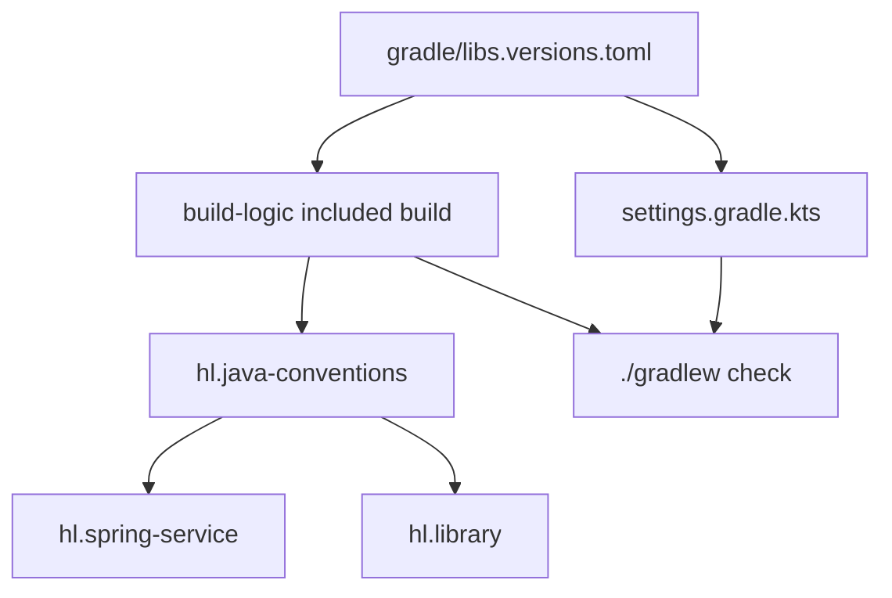

# EP-001: Monorepo and build conventions

| | |
|---|---|
| Status | Backlog |
| Phase | 0 |
| Owner | huylq |
| Last updated | 2026-11-08 |
| Services | `build-logic` |
| Size | M |
| Depends on | — |
| Unblocks | EP-002, EP-003 |

## Goal

One Gradle build pins Java 25, Spring Boot 4, and the test stack, and applies them through convention plugins. Later services register with a single `include` and a plugin id. They do not copy toolchains, BOMs, or test configuration into their own build scripts.

## Scope

In scope:

- Root settings, the Gradle wrapper, and `gradle/libs.versions.toml` as the only version catalog.
- `build-logic` as an included build that publishes `hl.java-conventions`, `hl.spring-service`, and `hl.library`.
- A root `./gradlew check` that compiles and tests every included project, including `build-logic`.
- Gradle TestKit coverage that proves each plugin applies its contract from a one-line `plugins` block.

Out of scope:

- `platform-*` module source. EP-002.
- Docker Compose, Kong, PostgreSQL, Kafka, and Redis. EP-003.
- `identity-service` and the probe application. EP-004.
- Hexagonal package rules. ArchUnit arrives with `platform-test` in EP-002. The package layout in HLD §5.1 starts with the first service.
- CI/CD, Kubernetes, and publishing artifacts to a remote repository.

## Design

EP-001 creates the build skeleton from HLD §5. It leaves `platform/` and `services/` empty until a later epic adds a module.

```
hl-payment/
├── settings.gradle.kts
├── build.gradle.kts
├── gradle/libs.versions.toml
├── gradle/wrapper/
├── gradlew
├── gradlew.bat
└── build-logic/
    ├── settings.gradle.kts
    ├── build.gradle.kts
    └── src/main/kotlin/
        ├── hl.java-conventions.gradle.kts
        ├── hl.spring-service.gradle.kts
        └── hl.library.gradle.kts
```

`rootProject.name` is `hl-payment`. Every project uses group `com.hl.payment` and version `0.0.1-SNAPSHOT`, set once on the root and inherited. The group matches the HLD package root `com.hl.payment`.



### Version catalog

`gradle/libs.versions.toml` is the single catalog. A library version appears there or it is supplied by the Spring Boot BOM. A `build.gradle.kts` file contains no version literal.

| Key | Role |
|---|---|
| `spring-boot` | The only Spring Boot version. The Boot BOM then supplies Spring Framework, Kafka clients, Flyway, JUnit Jupiter, and the PostgreSQL driver. |
| `testcontainers` | Declared in the catalog when the pinned Boot BOM does not already manage it. |
| `jspecify` | JSpecify annotations for `@NullMarked`. |
| `errorprone` | Present only when that release supports the Java 25 toolchain. |

`build-logic` is an included build, so it does not see the root catalog on its own. `build-logic/settings.gradle.kts` loads the same file:

```kotlin
dependencyResolutionManagement {
    repositories { mavenCentral() }
    versionCatalogs {
        create("libs") {
            from(files("../gradle/libs.versions.toml"))
        }
    }
}
```

Resolution is Maven Central only, in the root settings and in `build-logic`, with repositories mode set so a subproject cannot add another repository.

The Foojay toolchain resolver is a settings plugin. Its version lives in the root `settings.gradle.kts`, because settings plugins resolve before the catalog. That file is the only other place a version literal is allowed. The Gradle wrapper version lives in `gradle/wrapper/gradle-wrapper.properties` and is a release that runs on Java 25.

### Settings and module registration

`build-logic` is registered with `pluginManagement { includeBuild("build-logic") }`. It is an included build so the root build can apply the convention plugins. Type-safe project accessors are turned on.

A later module is one directory plus one include line:

```kotlin
include("platform:platform-bom")
```

The directory is `platform/platform-bom/` and its build file is:

```kotlin
plugins {
    id("hl.library")
}
```

A service uses `id("hl.spring-service")` the same way. EP-001 checks this in with TestKit. It does not add an empty `platform` or `services` project.

### Convention plugins

| Plugin | Applies | Puts on the classpath | Leaves to the module |
|---|---|---|---|
| `hl.java-conventions` | `java` | Java toolchain 25, UTF-8, `-parameters`, JSpecify, JUnit Jupiter with `useJUnitPlatform()`, Error Prone when the catalog defines it | Dependencies of the module |
| `hl.spring-service` | `hl.java-conventions`, Spring Boot | `spring-boot-starter-actuator`, the Boot 4 OpenTelemetry starter, `flyway-core` and the Flyway PostgreSQL module, `spring-boot-starter-test`, Testcontainers JUnit support | Web, JPA, Kafka, and the datasource URL |
| `hl.library` | `hl.java-conventions`, `java-library` | The `api` / `implementation` split | Everything else |

`hl.spring-service` imports the Spring Boot BOM through the Boot plugin. It does not apply a second BOM and it does not import `platform-bom`, which EP-002 creates.

JSpecify is a compile and test dependency from `hl.java-conventions`. Each module that contains production Java places `@NullMarked` on its root `package-info.java`. The plugin owns the dependency; the module owns the package annotation.

Flyway and the OpenTelemetry starter sit on the service classpath. Spring Boot keeps their auto-configuration inactive until a datasource or an exporter is configured, so the EP-004 probe can apply `hl.spring-service` before it has a database.

The OpenTelemetry coordinate is whatever the pinned Boot 4 reference documents for OTLP export. FT-002 records that alias in the catalog after checking the Boot 4 reference. The epic does not freeze a Boot 3 artifact name.

### Check

The root build applies the `base` plugin so `check` exists, and that task depends on `build-logic`'s `check`. Included projects contribute their own `check` through the root task graph.

`build-logic` verifies the three plugins with Gradle TestKit:

- A fixture whose only plugin is `hl.java-conventions` compiles with the Java 25 toolchain, runs a JUnit 5 test, and resolves JSpecify.
- A fixture whose only plugin is `hl.spring-service` resolves actuator, the OpenTelemetry starter, Flyway, and Testcontainers, and has an empty dependency block.
- A fixture whose only plugin is `hl.library` applies `java-library` and has no `bootJar` task.

`./gradlew check` is the local gate. There is no second script.

## Features

| ID | Feature | Status |
|---|---|---|
| FT-001 | [Version catalog and settings](../features/FT-001-version-catalog-and-settings.md) | Backlog |
| FT-002 | Convention plugins | Backlog |
| FT-003 | Single check entrypoint | Backlog |

FT-002 and FT-003 are not split yet. When they are, use `../features/FT-002-convention-plugins.md` and `../features/FT-003-single-check-entrypoint.md`. Stories stay in the [delivery plan](../delivery-plan.md) until then: US-001 and US-002 under FT-001, US-003 through US-005 under FT-002, US-006 under FT-003.

## Success criteria

- On a clean checkout, `./gradlew check` exits 0 and runs the `build-logic` TestKit tests.
- The Spring Boot version appears only in `gradle/libs.versions.toml`. Kafka, Flyway, JUnit, and Testcontainers versions appear only there or via the Boot BOM. No `build.gradle.kts` contains a version literal.
- A TestKit fixture applies `hl.java-conventions` alone and compiles as Java 25, runs JUnit 5, and resolves JSpecify.
- A TestKit fixture applies `hl.spring-service` alone and resolves actuator, the Boot 4 OpenTelemetry starter, Flyway, and Testcontainers.
- A TestKit fixture applies `hl.library` alone, applies `java-library`, and has no `bootJar` task.
- Registering a module is one `include` in `settings.gradle.kts` plus one build file whose `plugins` block names a convention plugin.

## Architecture references

- HLD sections: [§2 Technology stack](../../architecture/high-level-design.md#2-technology-stack), [§5 Repository layout](../../architecture/high-level-design.md#5-repository-layout).
- ADRs: none implemented here. The `platform/` and `services/` slots are the layout [ADR-0003](../../architecture/adr/ADR-0003-platform-libraries-not-service.md) fills in EP-002. This epic adds no `common-service` module.
- Domain events introduced or changed: none.

## Risks and open questions

- `build-logic` loads `../gradle/libs.versions.toml` explicitly. A second catalog inside `build-logic` would let plugin dependencies drift from the services. The TestKit build asserts plugin dependencies resolve from that file.
- The Boot 4 OpenTelemetry starter may differ in name from Boot 3. FT-002 copies the coordinate from the pinned Boot 4 reference into the catalog.
- Error Prone is part of `hl.java-conventions` when its release supports Java 25. When it does not, the catalog omits the `errorprone` key and the plugin skips the compiler integration. The toolchain, JSpecify, and JUnit defaults still ship.
- Open questions: none. Patch versions of Gradle, Spring Boot, and Testcontainers are recorded in the catalog and the wrapper when FT-001 is implemented.
